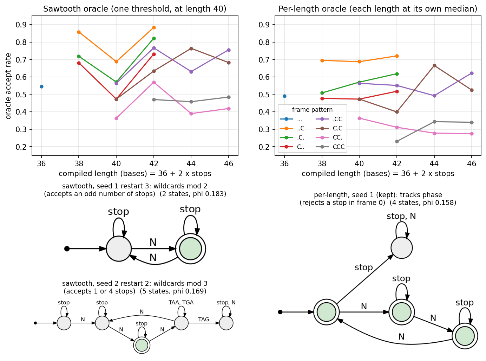

# Sawtooth vs per-length oracle

On the sawtooth oracle the learner finds DFAs that count wildcards, which tracks the
number of stops and so the compiled length.  On the per-length oracle the counting is
worth nothing and it finds the frame-0 rule: accept iff no stop starts at a base
position divisible by 3.

## Setup

Both oracles score strings with the len40 gate-residual model (`len_lo=35`, `len_hi=85`).
The sawtooth oracle (`saw`, the harness default `gate_residual_oracle`) thresholds every
string at the median for compiled length 40; the per-length oracle (`flat`) thresholds
each compiled length 35-85 at its own median.  Everything else is shared: 36-symbol
probes, selection samples and test strings, round 0 only, 4 restarts, seeds 0-3.  A search
stops and reverts on one held-out sample and the restart kept is the best on a second one
(4176d2ea).

The runs used 7daaa3b7 with the changes later committed as 4176d2ea and cd54dcba
(`held_out_phi` scoring each state's verdict, which is what the searches stop on and the
restarts are ranked by).

    PYTHONPATH=. python -u orthogonal_dfa/experiments/level5_real_oracle/length_oracles.py \
        --oracle saw --seed $s --out OUT/saw_s$s
    PYTHONPATH=. python -u orthogonal_dfa/experiments/level5_real_oracle/length_oracles_label.py OUT/labels.npz
    PYTHONPATH=. python orthogonal_dfa/experiments/level5_real_oracle/length_oracles_extract.py \
        OUT/labels.npz OUT/length_oracles_data.json OUT/saw_s{0,1,2,3} OUT/flat_s{0,1,2,3}
    python orthogonal_dfa/experiments/level5_real_oracle/length_oracles_figure.py \
        OUT/length_oracles_data.json OUT/figure

The extract step is the last that needs the runs or this repo; `length_oracles_data.json`
here is its output for the runs below, so the figure and tables re-render from it alone.
It holds counts rather than rates: oracle accepts per half, stop count and frame pattern,
and for every restart its DFA, pick and search scores, ending, probes, and the strings
ending in each state per half, stop count and frame pattern with their oracle accepts.

Runs took 2.1-6.9 h each (sawtooth mean 4.1 h, per-length 4.6 h).

Every DFA below is read on the same 200,000 fresh strings, each with its own oracle's
labels: a state accepts iff its strings in the first 100,000 accept above that half's
rate, and phi and rule agreements are read on the other 100,000.  Drawn DFAs are minimised under those labels.

## The oracles

With 36 symbols the compiled length is 36 + 2 x stops, so length and stop count are the
same thing; the panels split by frame pattern (which of the three frames has a stop) to
take out the frame effect, which also falls with the stop count.  Within every pattern
the sawtooth oracle accepts lengths 38 and 42 .15-.25 more often than 40 (`..C`: .86,
.69, .88); the per-length oracle is roughly flat (`..C`: .69, .69, .72).  At length 40 the
two agree, as both use length 40's median there.

Fixed rules on each oracle:

| rule | phi, sawtooth | phi, per-length |
|---|---|---|
| exactly one stop | .191 | .089 |
| odd number of stops | .183 | .009 |
| frames 0 and 1 not both closed | .166 | .176 |
| no stop in frame 0 | .140 | .158 |

## What the learner finds

|  | sawtooth | per-length |
|---|---|---|
| restarts that are exact wildcard-parity counters | 2/16 | 0/16 |
| restarts agreeing >= .85 with "exactly one stop" | 6/16 | 0/16 |
| restarts agreeing >= .95 with "no stop in frame 0" | 0/16 | 5/16 |
| kept DFAs' phi | .192, .195, .176, .188 | .158, .158, .157, .120 |

On the sawtooth oracle the two parity counters (seed 1 restart 3, seed 3 restart 3)
minimise to the same 2 states: wildcards mod 2, stops self-loop.  Seed 2 restart 2 counts
wildcards mod 3 and accepts 1 or 4 stops.  The kept DFAs are not pure counters: all four
reject every stop-free string and mostly accept one-stop strings, mixed with some frame
structure (agreement with "exactly one stop" .78-.86, with "no stop in frame 0" at most
.67).  Both parity counters lost the pick narrowly (.195 vs .202, .183 vs .184).

On the per-length oracle the kept DFAs of seeds 0 and 1 are exactly "no stop in frame 0"
(seed 1's in 4 states: the phase, and a sink once a stop lands in frame 0), seed 2's
agrees .97, and seed 3's is a weaker frame DFA (.71).  No restart counts.

The figure script prints every restart's phi, pick score, state counts, NMI of its end
state with wildcards mod k and with the frame pattern, stop self-loops and rule agreements.

## Notes

Seed 2's sawtooth run reports phi .105 for its kept DFA on its own test halves, against
.176 on its pick sample and on the 200,000 strings; 6,000-string halves resampled from
the 200,000 fall below .12 1% of the time.  Its test halves lift wildcards with the run's
seed rather than 0, which is the likely difference; it is not checked.

`SAWTOOTH_COUNTING.md`'s runs also used 36-symbol strings throughout; "length 40" there
is the oracle's threshold length, as here.
